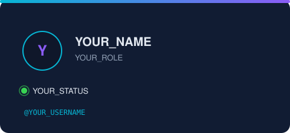
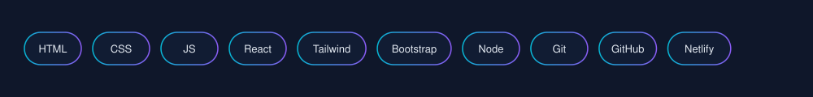

## About

- 🔭 I'm **YOUR_ROLE** — YOUR_TAGLINE
- 🌱 Currently learning: YOUR_CURRENT_LEARNING
- ⚡ Status: YOUR_STATUS — open to collaborations
- 💻 Daily OS: YOUR_OS

## Skills

## Featured Projects

## GitHub Stats

## Connect

Footer line — e.g. "This design is from github-profile-designs".

