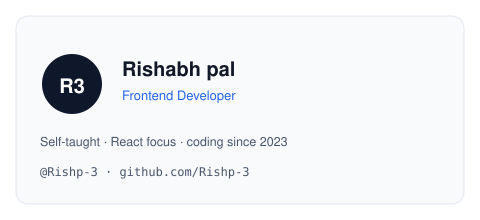
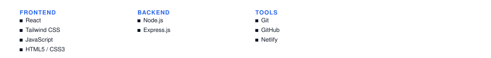

### Self-taught Frontend Developer specialising in React. I build clean, responsive user interfaces and I am progressing toward full stack development.

## Skills

## Featured Projects

## GitHub Stats

## Connect

Design `20-portfolio-pro` from **github-profile-designs** · made with self-contained SVG

